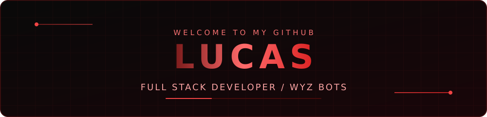

<div align="center">



<br />

**Desenvolvedor Full Stack • Taubaté, São Paulo 🇧🇷**

Construindo soluções digitais com foco em **performance**, **automação**, **segurança** e **experiências modernas**.

<br />

[](https://wyzbots.com.br)
[](https://discord.gg/wyz)
[](https://github.com/demonizedkid)

<br />


</div>

---

### About Me

```typescript
const lucas = {
  name: "Lucas",
  username: "demonizedkid",
  location: "Taubaté, São Paulo, Brazil",
  role: "Full Stack Developer",
  organization: "Wyz Bots",
  projects: ["Wyz Bots", "WyzCine", "WyzScrypt"],
  interests: ["Web Development", "Automation", "Cybersecurity"],
  motto: "Build. Improve. Innovate."
};
```

> Sou o Lucas, desenvolvedor interessado em criar plataformas digitais, automações e interfaces que unem desempenho, usabilidade e identidade visual. Trabalho em projetos da Wyz Bots e estou sempre explorando novas tecnologias.

---

### Tech Stack & Tools

**Languages**


**Frontend**


**Backend & Databases**


**Developer Tools**


---

### Featured Projects

#### ⚙️ [Wyz Bots](https://wyzbots.com.br) — Discord Automation

> Soluções para automação e gerenciamento de comunidades no Discord, com foco em ferramentas administrativas, experiência de uso e sistemas integrados.

`Discord.js` · `Node.js` · `Automation` · `Dashboards`

#### 🎬 WyzCine — Entertainment Platform

> Projeto de plataforma digital de entretenimento com foco em uma interface moderna, navegação fluida, personalização e performance.

`Next.js` · `React` · `TypeScript` · `UI/UX`

#### 🎮 WyzScrypt — Future Project

> **Em planejamento.** Futuro projeto de desenvolvimento de cheats para jogos, com estudo de programação, engenharia de software e funcionamento de sistemas de jogos. Ainda não lançado.

`Planned` · `Game Software` · `Development`

---

<div align="center">

### Connect With Me

[](https://wyzbots.com.br)
[](https://discord.gg/wyz)
[](https://github.com/demonizedkid)

<br />

**DESIGN · DEVELOP · SECURE · INNOVATE**

<sub>BUILT BY LUCAS · WYZ BOTS</sub>

</div>
